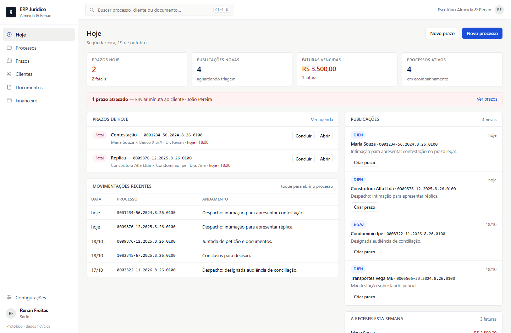

# ERP Jurídico — protótipo visual

Protótipo **estático** de um ERP para escritórios de advocacia de até 5 advogados.
Sem backend, sem build e sem dependências externas: um único `index.html` que abre
com duplo clique.



**Demonstração online:** https://reneleonreguero.github.io/erpadvocacia/

## Que dores o protótipo resolve

| Dor do dia a dia | Como aparece no protótipo |
|---|---|
| Prazo fatal esquecido | Tela **Hoje** com prazos do dia, fatais em vermelho e atrasados em faixa de alerta |
| Publicação do DJEN sem tratamento | Caixa de **Publicações** com botão "Criar prazo" já vinculado ao processo |
| Processo espalhado em vários sistemas | Página do processo com andamentos, prazos, documentos e financeiro |
| Honorário esquecido | Faturas vencidas em destaque, com baixa em um clique |
| Horas não lançadas | Lançamento rápido de horas vinculado ao processo |
| Documento perdido | Modelos prontos e arquivos indexados por processo e cliente |

## Telas

1. **Hoje** — prazos, publicações, movimentações e valores a receber.
2. **Processos** — busca, filtros por status, responsável e cliente.
3. **Processo** — andamentos, prazos, documentos, financeiro e dados.
4. **Prazos** — agenda semanal (segunda a sexta) com navegação entre semanas.
5. **Clientes** — carteira com processos ativos, último contato e valores em aberto.
6. **Documentos** — modelos e arquivos.
7. **Financeiro** — faturas, vencidos, recebidos e horas.

## Interações funcionais

- Navegação lateral e links diretos por hash (`#financeiro`, `#processo/p1`).
- Busca global com `Ctrl K` / `⌘ K` (Enter leva para a lista de processos).
- Criar prazo, processo, cliente, lançamento de horas e documento.
- Concluir prazo, marcar fatura como paga, filtrar e navegar por semanas.
- Todos os dados são fictícios e ficam em memória: ao recarregar, tudo volta ao estado inicial.

## Como abrir

```text
Duplo clique em index.html
```

Ou arraste o arquivo para o navegador. Não precisa instalar nada.

## Publicar no GitHub Pages

```bash
git init
git add index.html preview.png README.md
git commit -m "Protótipo visual do ERP jurídico"
git branch -M main
git remote add origin https://github.com/SEU-USUARIO/SEU-REPO.git
git push -u origin main
```

Depois: **Settings → Pages → Source: Deploy from a branch → main / (root) → Save**.
A URL fica no formato `https://SEU-USUARIO.github.io/SEU-REPO/`.

## Estrutura

```text
index.html    protótipo completo (HTML + CSS + JS)
preview.png   captura da tela Hoje
README.md     este arquivo
```

## Limites deste protótipo

- Não há backend, autenticação, banco de dados nem upload real.
- Datas são calculadas a partir do dia em que o arquivo é aberto.
- Integrações com tribunais, assinatura eletrônica e emissão fiscal são apenas representadas na interface.
- O objetivo é validar o visual e o fluxo antes de qualquer implementação.
